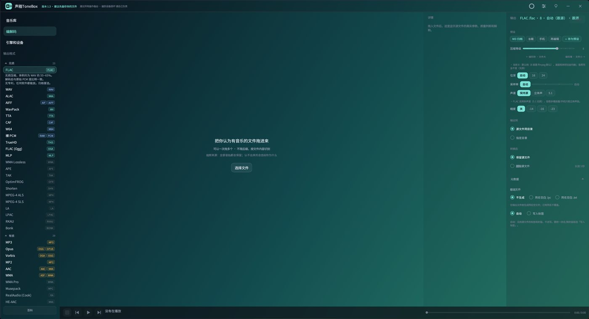

# ToneBox — an audio format advisor and converter

> A converter that tells you what a conversion will cost **before** you commit.
>
> Conversion is only the entry point; the real job is laying the format knowledge out in front of you.

[简体中文](README.md) · English


-orange)

---

## Who it is for

- **People who want to know the cost**: what really changes between MP3, Opus and AAC; how sample rate,
  bit depth and channels are altered; which formats are read-only.
- **People with odd files**: PSF/SPC/VGM chiptunes, PS1 XA, N64 VADPCM, BRSTM, MOD/XM, CUE sheets.
- **People archiving in bulk**: keep tags, cover art and ReplayGain, and re-probe every output afterwards.

**Not for** people who just want "one click, stable output, no questions". ToneBox puts limits and
trade-offs in front of you, which can be annoying.

---

## In one minute

**What it does**

- **112 output targets**: 65 audio codecs/containers + 36 video containers + 11 device formats;
  plus 47 read-only reference formats
- **Explains the cost**: patent status, size ratio, cutoff frequency, resampling/channel changes
- **Acts as an advisor**: tells you what a step will lose before you run it

**What it does not do**

- **No DRM**: NCM / QMC / KGM / OMA are only inspected for plaintext cover art and footer metadata.
  There is **no decryption code**.
- **No fake support**: formats without an encoder are greyed out with a reason
  (APE / TAK / DSD / WMA Lossless are read-only)
- **No network**: no upload, no telemetry, no streaming downloads

---

## Interface



The panel on the right is the format advisor: select a target and it lists the cost, limits and
typical use. Read-only formats are greyed out on the left, with a reason on hover.

---

## Download

| Version | Package | Size | SHA256 |
|---|---|---|---|
| **1.6.1** | [ToneBox-1.6.1-win64.zip](https://github.com/TeiketsuCN/ToneBox/releases/download/v1.6.1/ToneBox-1.6.1-win64.zip) | 28.2 MB | `DFC03D29089F8F20BDA6EE4438A7FD8DC1175BFAB3ADD659C09F7DA2884A2FD2` |
| 1.6.1 extras | [ToneBox-1.6.1-extras-win64.zip](https://github.com/TeiketsuCN/ToneBox/releases/download/v1.6.1/ToneBox-1.6.1-extras-win64.zip) | 4.8 MB | `ADCEB7528927418B668A30BF6387003A6765D316FE925870C6CACA088D3AB1FC` |

- **Windows 10 / 11 x64**, portable, no installation
- Unzip and run `format-converter.exe`; do not move `ffmpeg\`, `speex\`, `wavpack\`, `musepack\` separately
- Writes no registry keys, installs no service; delete the folder to uninstall

### Why Windows only

Exclusive audio output, DSD DoP and device enumeration are tied directly to WASAPI. Porting is not a UI
change. macOS / Linux are on the roadmap with no ETA; the CLI can theoretically run under Wine
(untested, not promised).

### Optional extras package

The main package omits tools that are large or have redistribution limits. Grab
`ToneBox-1.6.1-extras-win64.zip` if you need them:

| Tool | License | Purpose |
|---|---|---|
| **atracdenc** | LGPL-2.1 | ATRAC1 / ATRAC3 / ATRAC3+ |
| **psxavenc** | Zlib | PS1 XA-ADPCM / PS2 VAG |
| **VGAudioCli** | MIT | BRSTM / BCSTM / BFSTM / DSP / IDSP |
| **qoaconv** | MIT | QOA |
| **vadpcm** | MPL-2.0 | N64 VADPCM (`.aifc`) |
| **vgmstream** | ISC | PSF / ADS / BRSTM / BCSTM / HCA input |
| **openmpt123** | BSD-3-Clause | MOD / XM / IT / S3M input |
| **OptimFROG** | freeware, closed | `install-ofr.cmd` downloads it from the official site with SHA-1 check; not redistributed |

Unzip the extras package **into the ToneBox folder** (next to `format-converter.exe`). Everything except
OptimFROG works immediately; double-click `install-ofr.cmd` once for that one. Then open
**Settings → Dependencies / external tools → Re-detect**.

> **Beta**: core conversion paths are covered by tests, but edge combinations (24-bit FLAC + filters,
> unusual containers) can still break. Back up originals; open an issue with the source info and
> `--health` output if something fails.

---

## How the numbers add up

"112" is not inflated with read-only formats:

| Category | Count | Examples |
|---|---|---|
| Audio codecs / containers | **65** | FLAC, MP3, Opus, AAC, AMR, Speex, QOA, WAV, CAF, BWF… |
| Video containers | **36** | MKV, MP4, WebM, MOV, MXF, VCD, AMV, GIF, APNG… |
| Device formats | **11** | ATRAC1/3/3+, PS1 XA, PS2 VAG, BRSTM, DSP, N64 VADPCM… |
| **Total output targets** | **112** | |
| Read-only references | 47 | APE, TAK, DSD, WMA Lossless, DTS-HD… |

"Read-only" does not mean "unsupported": those files work fine as input and can be converted to
FLAC / MP3 / WAV. The app just has no **encoder** for writing them.

### Common read/write boundaries

| Source | → FLAC | → MP3 | → WAV | As an output target |
|---|---|---|---|---|
| APE | ✅ | ✅ | ✅ | ❌ read-only |
| TAK | ✅ | ✅ | ✅ | ❌ read-only |
| DSD (DSF / DFF) | ✅ | ✅ | ✅ | ❌ read-only |
| WMA Lossless | ✅ | ✅ | ✅ | ❌ read-only |
| AMR | ✅ | ✅ | ✅ | ✅ AMR-NB / AMR-WB |
| MKA | ✅ | ✅ | ✅ | ❌ read-only (use MKV to mux) |

---

## Supported output formats

| Category | Targets |
|---|---|
| Lossless (13) | FLAC, WAV, ALAC, AIFF, WavPack, TTA, CAF, W64, raw PCM, TrueHD, MLP, Ogg FLAC, OptimFROG (needs ofr.exe) |
| Lossy (18) | MP3, Opus, Vorbis, MP2, AAC, WMA v1/v2, Musepack, QOA, aptX / aptX HD / SBC, ADX, lossy WavPack, Westwood AUD, KVAG, Argonaut ASF, APM |
| Spatial (5) | AC-3, E-AC-3, AC-4 (pass-through), DTS, AAC 5.1 |
| Speech / telephony (20) | G.711 A/μ, G.722, G.723.1, G.726, GSM 06.10, AMR-NB, AMR-WB, iLBC, LC3, Codec2, Speex, ADPCM family, DFPWM, RealAudio 1.0, Nellymoser, ALP |
| Audio containers (9) | VOC, AAC-LATM, IEC 61937, AU / SND, RF64, BWF, SMAF (MMF), SoX, IRCAM |
| Video containers (36) | MKV, MP4, WebM, MOV, TS, M2TS, FLV, AVI, MPEG-PS, VOB, OGV, WMV, 3GP, MXF, DV, GXF, NUT, MXF OPAtom, 3G2, F4V, ISMV, WTV, VCD, SVCD, PSP, iPod (M4V), IVF, H.264 / H.265 / MPEG-2 / MPEG-4 raw streams, AVIF, AMV, SWF, GIF, APNG |
| Device (11) | ATRAC1 / ATRAC3 / ATRAC3+ (atracdenc), PS1 XA / PS2 VAG (psxavenc), BRSTM / BCSTM / BFSTM / DSP / IDSP (VGAudioCli), N64 VADPCM (vadpcm) |

Video containers keep the first video stream plus all audio tracks. Video can be copied or encoded to
H.264 / H.265 / VP9 / AV1 / ProRes / DNxHR / FFV1 / VP8 / MJPEG / MPEG-2 / MPEG-4 / Theora / WMV2 / DV;
each audio track is set to copy or re-encode individually.

**Read-only formats** (parsed and explained, but no encoder): APE, TAK, Shorten, WMA Lossless,
DSD (DSF/DFF/DST), DTS-HD/X, MPEG-H, USAC, EVS, LC3plus, TwinVQ, RealAudio Cook, etc.

> Chiptunes (NSF / SPC / GBS / VGM / PSF …) **work as input**: the bundled ffmpeg renders them to PCM
> through libgme, then converts to FLAC/MP3. They are not waveform audio, so they cannot be output
> targets; rendering is limited to the first 3 minutes by default. See
> [docs/主机音频格式.md](docs/主机音频格式.md) (Chinese).

---

## External tools

| Tool | Bundled? | Purpose |
|---|---|---|
| `ffmpeg` / `ffprobe` | ✅ main | decode, encode, probe (self-built LGPL-2.1-or-later with libgsm / vo-amrwbenc / libilbc / liblc3 / codec2 / libgme) |
| `speexenc` | ✅ main | Speex output (BSD) |
| `wavpack` | ✅ main | lossy WavPack (hybrid mode) |
| `mpcenc` | ✅ main | Musepack output (LGPL-2.1) |
| `atracdenc` | 📦 extras | ATRAC1 / ATRAC3 / ATRAC3+ (LGPL-2.1) |
| `psxavenc` | 📦 extras | PS1 XA-ADPCM / PS2 VAG (Zlib) |
| `VGAudioCli` | 📦 extras | BRSTM / BCSTM / BFSTM / DSP / IDSP (MIT) |
| `qoaconv` | 📦 extras | QOA (MIT) |
| `vadpcm` | 📦 extras | N64 VADPCM (MPL-2.0) |
| `vgmstream` | 📦 extras | PSF / ADS / BRSTM / BCSTM / HCA input (ISC) |
| `openmpt123` | 📦 extras | MOD / XM / IT / S3M input (BSD-3-Clause) |
| `ofr` | ⬇️ downloaded by extras | OptimFROG (official license restricts redistribution) |

Tools are searched in "program directory → program subdirectories → PATH". After installing a new tool,
use **Settings → Dependencies / external tools → Re-detect**; no restart needed.

---

## Command line

```
format-converter.exe --version                 show version
format-converter.exe --help                    list all arguments
format-converter.exe --formats                 list output formats (id / name / extension)
format-converter.exe --convert in.flac out.mpc --to musepack [--vcodec prores]
format-converter.exe --tools                   detect ffmpeg / external encoders
format-converter.exe --devices                 list audio devices
format-converter.exe --play <file> [seconds]   play directly
format-converter.exe --health <file>           content health check
format-converter.exe --split-cue <cue> [--to flac] [--out-dir DIR]   split by CUE
format-converter.exe --register                register in "Open with"
format-converter.exe --unregister             remove the registration
format-converter.exe <file>                    open and play (same as double-click)
```

Format ids come from `--formats`; `--convert` dispatches to ffmpeg or the matching external encoder.

---

## How to verify this package

- **Not code-signed**: no certificate was purchased, so Windows SmartScreen may warn. Run it in a
  sandbox/VM if you prefer, or upload it to VirusTotal yourself (we do not fabricate a scan link).
- **Check SHA256** (PowerShell):

  ```powershell
  Get-FileHash .\ToneBox-1.6.1-win64.zip -Algorithm SHA256
  ```

  Compare it with the value above, character by character.
- **Build it yourself**: commands below; anyone can reproduce the package from the scripts in this repo.
- **Bundled ffmpeg**: built from FFmpeg sources by [`tools/build-ffmpeg.sh`](tools/build-ffmpeg.sh)
  (LGPL-2.1-or-later, no GPL components). The build script and third-party notices are in the repo.
- **CI today**: [`.github/workflows/ci.yml`](.github/workflows/ci.yml) runs `cargo test` on push/PR.
  **Release packages are currently built locally with `tools/package-release.ps1`** (commands below);
  CI-built releases are planned, and we will not put unverified claims in this README.

---

## Building

Rust with the MSVC or GNU toolchain (1.75+). The repo does not ship binaries; fetch the bundled tools first:

```powershell
# 1. fetch dependencies (ffmpeg / speex / wavpack / musepack)
powershell -ExecutionPolicy Bypass -File tools\fetch-ffmpeg.ps1
powershell -ExecutionPolicy Bypass -File tools\fetch-speex.ps1
powershell -ExecutionPolicy Bypass -File tools\fetch-wavpack.ps1

# optional: tools used by the extras package
powershell -ExecutionPolicy Bypass -File tools\fetch-atracdenc.ps1
powershell -ExecutionPolicy Bypass -File tools\fetch-psxavenc.ps1
powershell -ExecutionPolicy Bypass -File tools\fetch-vgaudio.ps1
powershell -ExecutionPolicy Bypass -File tools\fetch-qoa.ps1
powershell -ExecutionPolicy Bypass -File tools\fetch-vgmstream.ps1
powershell -ExecutionPolicy Bypass -File tools\fetch-openmpt123.ps1
powershell -ExecutionPolicy Bypass -File tools\fetch-optimfrog.ps1

# 2. build
cargo build --release -p fc-gui

# 3. tests (format table, argument mapping, warnings, container matrix, CUE parser)
cargo test -p fc-core --lib

# 4. package (version read from Cargo.toml)
powershell -ExecutionPolicy Bypass -File tools\package-release.ps1
powershell -ExecutionPolicy Bypass -File tools\package-extras.ps1
```

To rebuild the bundled ffmpeg (speech codecs + libgme): see
[`tools/build-ffmpeg.sh`](tools/build-ffmpeg.sh) and [`tools/build-ffmpeg.ps1`](tools/build-ffmpeg.ps1);
the first build takes roughly 20–40 minutes.

---

## Design rules

- **Local only**: no network, no upload, no DRM circumvention, no copyright-protection bypass
- **No pretending**: formats without an encoder are greyed out with a reason; nothing unsupported is
  listed as supported
- **Never modify your files**: only new files are written, unless you explicitly choose "delete source"
- **Clean licensing**: app is MIT; bundled ffmpeg is **LGPL-2.1-or-later** (no GPL components);
  `ofr.exe` is not redistributed

---

## Known issues

- 24-bit FLAC + trim/filters can make the bundled ffmpeg report `invalid block size`; a two-step
  workaround is built in
- Some Android recordings (.amr) have non-standard duration metadata and may display short
- ATRAC9 is read-only: atracdenc does not support it and patents are still in force
- Video containers keep only the first video stream; multi-angle video is not handled
- Chiptunes render for 3 minutes by default (NSF/SPC have no track length; libgme loops forever)
- **HE-AAC / xHE-AAC / AAC-ELD can be decoded** (native ffmpeg), **but not encoded**
  (encoding needs libfdk-aac, non-free)
- APE / TAK / DSD / AIFC / BW64 have no usable encoder and are read-only references

---

## License and third parties

- Application: **MIT** (see [`LICENSE`](LICENSE))
- Bundled ffmpeg: **LGPL-2.1-or-later**; license files kept, DLL replacement allowed, build scripts provided
- Other bundled/optional components (Speex, WavPack, libgme, libopenmpt, psxavenc, VGAudio, QOA,
  vgmstream, etc.): see [`THIRD_PARTY_NOTICES.md`](THIRD_PARTY_NOTICES.md)

---

## Changelog

### 1.7 (in development, unreleased)
- Output targets **107 → 112**: Argonaut ASF, AMV, SWF, GIF, APNG; ProRes / FFV1 / DNxHR / VP8 / MJPEG
  encoders for MOV/MKV/MXF/WebM/AVI
- **Double-click to play**: launching with a file path queues it and starts playback
- **"Open with" registration**: `--register` / Settings button; never silently steals the default
- **vgmstream input**: PSF / PS2 ADS / BRSTM / BCSTM / BFSTM / HCA are decoded to WAV first
- **openmpt123 input**: MOD / XM / IT / S3M modules can be dropped in directly
- **Post-conversion check**: every output is re-probed; broken files or wildly wrong durations fail loudly
- **ReplayGain tag writing**: source `replaygain_track_gain` is carried into FLAC / MP3 outputs
- **CUE splitting**: `--split-cue album.cue --to flac --out-dir out`, or the Settings button; writes
  track number / title / artist

### 1.6.1 (2026-11)
- Output targets **106 → 107**: N64 VADPCM (`.aifc`, external vadpcm, MPL-2.0)
- N64 VADPCM accepts 16-bit mono only; all 1.6 capabilities kept

### 1.6.0 (2026-11)
- Output targets **95 → 106**
- VCD / SVCD / PSP / iPod (M4V), IVF, H.264 / H.265 / MPEG-2 / MPEG-4 raw streams, AVIF, KVAG
- Video-only containers no longer get a fake audio track; VCD/SVCD force 352×288 / 480×576 and MP2 224k
- All 1.5 input support, PS1/PS2, Nintendo containers and QOA kept

### 1.5.0 (2026-11)
- Output targets **73 → 95**
- **Chiptunes as input**: ffmpeg with libgme; NSF / SPC / GBS / VGM / PSF and more
- PS1 XA-ADPCM / PS2 VAG (psxavenc), QOA (qoaconv), BRSTM / BCSTM / BFSTM / DSP / IDSP (VGAudioCli)
- New video containers: DV, GXF, NUT, MXF OPAtom, 3G2, F4V, ISMV, WTV
- New legacy audio: Westwood AUD, APM, ALP, SMAF (MMF); containers SoX, IRCAM
- Fixed CLI hard-coding `libx264` although the bundled build only has libopenh264
- `--version` / `--help` became real CLI arguments
- Extras package gained psxavenc / VGAudioCli / qoaconv; packaging emits `SHA256SUMS`

### 1.4.0 (2026-11)
- Output targets **69 → 73**: VOC, AAC-LATM / LOAS, MXF, Musepack
- Bundled Musepack encoder (LGPL-2.1), works out of the box

### 1.3.1 (2026-11)
- OptimFROG output via the official ofr.exe
- Fixed CLI `--convert` not supporting external encoders
- Added the optional extras package

### 1.3 (2026-11)
- Output targets **43 → 68**: video containers 8 → 13, GSM / AMR-WB / iLBC / LC3 / Codec2 / DFPWM,
  lossy WavPack, IEC 61937, SND
- Bundled ffmpeg switched to a self-built 8.0 (LGPL-2.1-or-later, 152 MB → 59.6 MB)

### 1.2
- More formats (Speex / AMR-NB / G.711 / G.722 / ADPCM / AU / RF64 / BWF)
- Seven sidebar groups, read-only formats always visible, spectrum analysis power saving

### 1.0
- First public beta: three-pane UI, queue conversion, format encyclopedia, music library

---

## Sponsoring

The project is free and open source; voluntary sponsorship does not affect anyone's rights under MIT.


