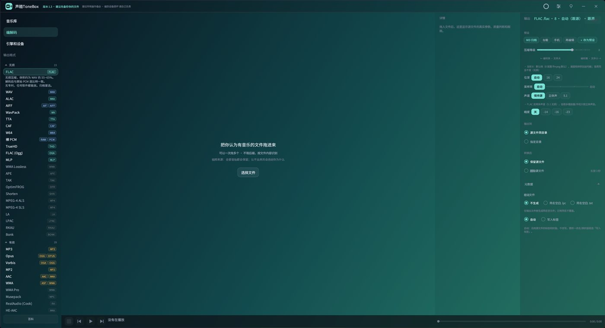

# ToneBox 声箱 — 音频格式顾问与转换器

> 一个讲道理的音频格式转换器：先告诉你「这么转会损失什么」，再让你决定。
>
> 转换只是入口，它真正干的事是把格式知识摊开给你看。

[English (short)](README.en.md) · [简体中文](README.md)


-orange)

---

## 它适合谁

- **想知道代价的人**：同一首歌转 MP3、Opus、AAC 到底差在哪，采样率/位深/声道会怎么被改，哪些格式只是“能读不能写”。
- **手里有奇怪文件的人**：PSF/SPC/VGM 芯片音乐、PS1 XA、N64 VADPCM、BRSTM、MOD/XM、CUE 整轨。
- **要批量归档的人**：需要保留标签、封面、ReplayGain，并且转完能回读自检。

**不适合谁**：只想“点一下、稳定出活、别问问题”的生产用户。ToneBox 会把限制和风险摆在你面前，有时这很烦。

---

## 一分钟了解

**能做什么**

- **112 个输出目标**：65 个音频编码/容器 + 36 个视频容器 + 11 个设备专用；另有 47 个只读参考格式
- **解释代价**：每个格式都写清楚有无专利、体积倍率、截止频率、会不会重采样/改声道
- **当顾问**：转之前就告诉你「这步会损失什么」，而不是转完才后悔

**不能做什么**

- **不解 DRM**：NCM / QMC / KGM / OMA 只读明文封面和尾部信息，**没有解密逻辑**
- **不假装支持**：没有编码器的格式灰显并说明原因（APE / TAK / DSD / WMA Lossless 等只读）
- **不联网、不上传、不做流媒体下载**：所有处理都在本机

---

## 界面



右侧面板就是“格式顾问”：选中一个输出格式，下面会列出它的代价、限制和适用场景。
左侧只读格式灰显，鼠标停上去会解释为什么不能输出。

---

## 下载

| 版本 | 包 | 大小 | SHA256 |
|---|---|---|---|
| **1.6.1** | [ToneBox-1.6.1-win64.zip](https://github.com/TeiketsuCN/ToneBox/releases/download/v1.6.1/ToneBox-1.6.1-win64.zip) | 28.2 MB | `DFC03D29089F8F20BDA6EE4438A7FD8DC1175BFAB3ADD659C09F7DA2884A2FD2` |
| 1.6.1 可选工具 | [ToneBox-1.6.1-extras-win64.zip](https://github.com/TeiketsuCN/ToneBox/releases/download/v1.6.1/ToneBox-1.6.1-extras-win64.zip) | 4.8 MB | `ADCEB7528927418B668A30BF6387003A6765D316FE925870C6CACA088D3AB1FC` |

- **Windows 10 / 11 x64**，解压即用，不需要安装
- 解压后双击 `format-converter.exe`；不要单独移动 `ffmpeg\`、`speex\`、`wavpack\`、`musepack\` 四个目录
- 解压即用、不写注册表、不装服务；删掉文件夹就是卸载

### 为什么只有 Windows

音频独占、DSD DoP、设备枚举都直接绑在 WASAPI 上，换平台不是改个 UI。macOS / Linux 在路线图上，
但还没有时间表；当前理论上可以用 Wine 跑 CLI（未验证，不承诺）。

### 可选外部工具包（单独下载）

主包不带分发受限或体积较大的工具，需要时另下 `ToneBox-1.6.1-extras-win64.zip`：

| 工具 | 许可 | 用途 |
|---|---|---|
| **atracdenc** | LGPL-2.1 | ATRAC1 / ATRAC3 / ATRAC3+ |
| **psxavenc** | Zlib | PS1 XA-ADPCM / PS2 VAG |
| **VGAudioCli** | MIT | BRSTM / BCSTM / BFSTM / DSP / IDSP |
| **qoaconv** | MIT | QOA |
| **vadpcm** | MPL-2.0 | N64 VADPCM（`.aifc`） |
| **vgmstream** | ISC | PSF / ADS / BRSTM / BCSTM / HCA 等输入 |
| **openmpt123** | BSD-3-Clause | MOD / XM / IT / S3M 等模块输入 |
| **OptimFROG** | 闭源免费 | `install-ofr.cmd` 从官网下载 + SHA-1 校验，不再分发 |

用法：把 extras 包**解压到 ToneBox 目录**（和 `format-converter.exe` 同级），除 OptimFROG 外都立刻可用；
OptimFROG 双击一次 `install-ofr.cmd`。装完回程序里点 **设置 → 依赖 / 外部工具 → 重新检测**。

> **Beta 阶段**：核心转换路径有测试覆盖，边界组合（如 24bit FLAC + 滤镜、特殊容器）仍可能踩坑。
> 建议先备份原文件；遇到问题请开 issue，附上源文件信息与 `--health` 输出。

---

## 格式数字怎么算

「112 个」不是把只读格式也算进去凑数：

| 类别 | 数量 | 例子 |
|---|---|---|
| 音频编码 / 容器 | **65** | FLAC、MP3、Opus、AAC、AMR、Speex、QOA、WAV、CAF、BWF… |
| 视频容器 | **36** | MKV、MP4、WebM、MOV、MXF、VCD、AMV、GIF、APNG… |
| 设备专用 | **11** | ATRAC1/3/3+、PS1 XA、PS2 VAG、BRSTM、DSP、N64 VADPCM… |
| **合计可输出** | **112** | |
| 只读参考（能读不能写） | 47 | APE、TAK、DSD、WMA Lossless、DTS-HD… |

「只读」不是“不支持”：这些文件可以正常当输入，转成 FLAC / MP3 / WAV 都没问题，只是本程序不提供**写入**它们的编码器。

### 常见格式的读写边界

| 源格式 | → FLAC | → MP3 | → WAV | 作为输出目标 |
|---|---|---|---|---|
| APE | ✅ | ✅ | ✅ | ❌ 只读 |
| TAK | ✅ | ✅ | ✅ | ❌ 只读 |
| DSD（DSF / DFF） | ✅ | ✅ | ✅ | ❌ 只读 |
| WMA Lossless | ✅ | ✅ | ✅ | ❌ 只读 |
| AMR | ✅ | ✅ | ✅ | ✅ AMR-NB / AMR-WB |
| MKA | ✅ | ✅ | ✅ | ❌ 只读（要封装请用 MKV） |

---

## 支持的格式（可输出）

| 类别 | 可输出 |
|---|---|
| 无损（13） | FLAC、WAV、ALAC、AIFF、WavPack、TTA、CAF、W64、裸 PCM、TrueHD、MLP、Ogg FLAC、OptimFROG（需 ofr.exe） |
| 有损（18） | MP3、Opus、Vorbis、MP2、AAC、WMA v1/v2、Musepack、QOA、aptX / aptX HD / SBC、ADX、WavPack 有损、Westwood AUD、KVAG、Argonaut ASF、APM |
| 空间音频（5） | AC-3、E-AC-3、AC-4（直通）、DTS、AAC 5.1 |
| 语音/电话（20） | G.711 A/μ、G.722、G.723.1、G.726、GSM 06.10、AMR-NB、AMR-WB、iLBC、LC3、Codec2、Speex、ADPCM 系列、DFPWM、RealAudio 1.0、Nellymoser、ALP |
| 音频容器（9） | VOC、AAC-LATM、IEC 61937、AU / SND、RF64、BWF、SMAF（MMF）、SoX、IRCAM |
| 视频容器（36） | MKV、MP4、WebM、MOV、TS、M2TS、FLV、AVI、MPEG-PS、VOB、OGV、WMV、3GP、MXF、DV、GXF、NUT、MXF OPAtom、3G2、F4V、ISMV、WTV、VCD、SVCD、PSP、iPod (M4V)、IVF、H.264 / H.265 / MPEG-2 / MPEG-4 裸流、AVIF、AMV、SWF、GIF、APNG |
| 设备专用（11） | ATRAC1 / ATRAC3 / ATRAC3+（atracdenc）、PS1 XA / PS2 VAG（psxavenc）、BRSTM / BCSTM / BFSTM / DSP / IDSP（VGAudioCli）、N64 VADPCM（vadpcm） |

视频容器支持保留第一条画面 + 全部音轨；画面可复制或转 H.264 / H.265 / VP9 / AV1 / ProRes / DNxHR /
FFV1 / VP8 / MJPEG / MPEG-2 / MPEG-4 / Theora / WMV2 / DV，音轨逐条决定复制还是重编码。

**只读格式**（能解析、能解释为什么不能输出）：APE、TAK、Shorten、WMA Lossless、DSD（DSF/DFF/DST）、
DTS-HD/X、MPEG-H、USAC、EVS、LC3plus、TwinVQ、RealAudio Cook 等。

> 主机芯片音乐（NSF / SPC / GBS / VGM / PSF 等）**可以当输入**：随包 ffmpeg 用 libgme
> 渲染成 PCM，再转成 FLAC/MP3。它们本身不是波形音频，所以不能作为输出，
> 转换时默认只渲染前 3 分钟。细节见 [docs/主机音频格式.md](docs/主机音频格式.md)。

---

## 外部工具

| 工具 | 是否随包 | 用途 |
|---|---|---|
| `ffmpeg` / `ffprobe` | ✅ 主包 | 解码、编码、探测（LGPL-2.1-or-later 自建，带 libgsm / vo-amrwbenc / libilbc / liblc3 / codec2 / libgme） |
| `speexenc` | ✅ 主包 | Speex 输出（BSD） |
| `wavpack` | ✅ 主包 | WavPack **有损**输出（hybrid 模式） |
| `mpcenc` | ✅ 主包 | Musepack 输出（LGPL-2.1） |
| `atracdenc` | 📦 extras | ATRAC1 / ATRAC3 / ATRAC3+（LGPL-2.1） |
| `psxavenc` | 📦 extras | PS1 XA-ADPCM / PS2 VAG（Zlib） |
| `VGAudioCli` | 📦 extras | BRSTM / BCSTM / BFSTM / DSP / IDSP（MIT） |
| `qoaconv` | 📦 extras | QOA（MIT） |
| `vadpcm` | 📦 extras | N64 VADPCM（MPL-2.0） |
| `vgmstream` | 📦 extras | PSF / ADS / BRSTM / BCSTM / HCA 等输入（ISC） |
| `openmpt123` | 📦 extras | MOD / XM / IT / S3M 等模块输入（BSD-3-Clause） |
| `ofr` | ⬇️ extras 内一键下载 | OptimFROG（官方许可限制再分发） |

程序会自动在「程序目录 → 程序目录子目录 → PATH」里找这些工具。
装了新工具后，到 **设置 → 依赖 / 外部工具 → 重新检测** 即可，不用重启。

---

## 命令行

```
format-converter.exe --version                 显示版本
format-converter.exe --help                    列出全部参数
format-converter.exe --formats                 列出可输出格式（id / 名称 / 后缀）
format-converter.exe --convert in.flac out.mpc --to musepack [--vcodec prores]
format-converter.exe --tools                   探测 ffmpeg / 各外部编码器
format-converter.exe --devices                 列出音频设备
format-converter.exe --play <file> [秒数]       直接试听
format-converter.exe --health <file>           内容体检
format-converter.exe --split-cue <cue> [--to flac] [--out-dir 目录]   按 CUE 分轨
format-converter.exe --register                注册到「打开方式」
format-converter.exe --unregister              移除注册
format-converter.exe <文件>                     打开并直接试听（双击文件的效果）
```

格式 id 见 `--formats`；`--convert` 会自动分派给 ffmpeg 或对应的外部编码器。

---

## 怎么验证这个包

- **没有代码签名**：项目没有购买证书，Windows 可能弹 SmartScreen。介意的话先在沙箱/虚拟机里跑，
  或把包传到 VirusTotal 自行扫描（我们没有预先生成的扫描链接，不伪造）。
- **校验 SHA256**（PowerShell）：

  ```powershell
  Get-FileHash .\ToneBox-1.6.1-win64.zip -Algorithm SHA256
  ```

  和上面的值逐字比对。
- **自己构建**：命令见下面「构建」，任何人可以用仓库里的脚本复现同一个包。
- **随包 ffmpeg**：由 [`tools/build-ffmpeg.sh`](tools/build-ffmpeg.sh) 从 FFmpeg 源码构建（LGPL-2.1-or-later，
  不含 GPL 组件），构建脚本和第三方许可都在仓库里。
- **CI 现状**：[`.github/workflows/ci.yml`](.github/workflows/ci.yml) 在 push/PR 上跑 `cargo test`；
  **发布包目前由本地 `tools/package-release.ps1` 构建**（命令见下），CI 自动出包还在计划中，不想把没验证的东西写进 README。

---

## 构建

需要 Rust 的 MSVC 或 GNU 工具链（1.75+）。仓库不含二进制依赖，首次构建前先抓取随包工具：

```powershell
# 1. 抓依赖（ffmpeg / speex / wavpack / musepack）
powershell -ExecutionPolicy Bypass -File tools\fetch-ffmpeg.ps1
powershell -ExecutionPolicy Bypass -File tools\fetch-speex.ps1
powershell -ExecutionPolicy Bypass -File tools\fetch-wavpack.ps1

# 可选：extras 包用到的外部工具
powershell -ExecutionPolicy Bypass -File tools\fetch-atracdenc.ps1
powershell -ExecutionPolicy Bypass -File tools\fetch-psxavenc.ps1
powershell -ExecutionPolicy Bypass -File tools\fetch-vgaudio.ps1
powershell -ExecutionPolicy Bypass -File tools\fetch-qoa.ps1
powershell -ExecutionPolicy Bypass -File tools\fetch-vgmstream.ps1
powershell -ExecutionPolicy Bypass -File tools\fetch-openmpt123.ps1
powershell -ExecutionPolicy Bypass -File tools\fetch-optimfrog.ps1

# 2. 编译
cargo build --release -p fc-gui

# 3. 测试（格式表、参数映射、警告逻辑、容器矩阵、CUE 解析）
cargo test -p fc-core --lib

# 4. 打包（版本号从 Cargo.toml 读）
powershell -ExecutionPolicy Bypass -File tools\package-release.ps1
powershell -ExecutionPolicy Bypass -File tools\package-extras.ps1
```

想自己重新构建随包 ffmpeg（带语音编码库 + libgme）：见
[`tools/build-ffmpeg.sh`](tools/build-ffmpeg.sh) 与 [`tools/build-ffmpeg.ps1`](tools/build-ffmpeg.ps1)；
首次约 20~40 分钟。

---

## 设计红线

- **只做本地处理**：不联网、不上传、不解 DRM、不绕过任何版权保护
- **不假装**：没有编码器的格式就灰着并说明原因；做不到的事不写进格式表
- **不改你的文件**：除非你明确选择「删除源文件」，否则只写新文件
- **许可干净**：程序本体 MIT；随包 ffmpeg 是 **LGPL-2.1-or-later**（不含 GPL 组件）；
  `ofr.exe` 不随包分发

---

## 已知问题

- FLAC + 24bit + 截取/滤镜的组合，随包 ffmpeg 可能报 `invalid block size`：程序已内置两段式规避
- 部分 Android 录音（.amr）时长元数据不规范，显示可能偏短
- ATRAC9 只读：atracdenc 不支持，专利也在保护期
- 视频容器只保留第一条画面；多画面（多角度）不处理
- 芯片音乐默认只渲染 3 分钟（NSF/SPC 没有曲目长度字段，libgme 会一直循环）
- **HE-AAC / xHE-AAC / AAC-ELD：能解码**（ffmpeg 原生），**不提供编码**（要 libfdk-aac，非自由）
- APE / TAK / DSD / AIFC / BW64 输出没有可用编码器，归入只读参考

---

## 许可与第三方

- 程序本体：**MIT**（见 [`LICENSE`](LICENSE)）
- 随包 ffmpeg：**LGPL-2.1-or-later**，保留许可文件、允许替换 DLL、提供构建脚本
- 其他随包/可选组件（Speex、WavPack、libgme、libopenmpt、psxavenc、VGAudio、QOA、vgmstream 等）
  的许可与来源见 [`THIRD_PARTY_NOTICES.md`](THIRD_PARTY_NOTICES.md)

---

## 更新日志

### 1.7（开发中，未发版）
- 可输出格式 **107 → 112**：Argonaut ASF、AMV、SWF、GIF、APNG；MOV/MKV/MXF/WebM/AVI 新增 ProRes / FFV1 / DNxHR / VP8 / MJPEG 编码
- **双击文件直接播放**：带文件路径启动会入队并自动试听
- **注册到「打开方式」**：`--register` / 设置页按钮；不静默抢默认（Windows 要求用户确认）
- **vgmstream 输入**：PSF / PS2 ADS / BRSTM / BCSTM / BFSTM / HCA 可以先解成 WAV 再转（extras 里带）
- **openmpt123 输入**：MOD / XM / IT / S3M 等模块音乐可以直接拖进来（extras 里带）
- **转换后自检**：每个输出都重新 probe，坏文件/时长离谱直接标失败，不假装成功
- **ReplayGain 标签写入**：源文件的 `replaygain_track_gain` 会带进 FLAC / MP3 等输出
- **CUE 分轨**：`--split-cue album.cue --to flac --out-dir out`，或设置页「CUE 分轨」按钮；按 TRACK/INDEX 切轨并写轨号/标题/艺术家

### 1.6.1（2026-11）
- 可输出格式 **106 → 107**：新增 **N64 VADPCM**（`.aifc`，外部 vadpcm，MPL-2.0）
- N64 VADPCM 只收 16-bit 单声道；1.6 的能力全部保留

### 1.6.0（2026-11）
- 可输出格式 **95 → 106**
- 新增 VCD / SVCD / PSP / iPod (M4V)、IVF、H.264 / H.265 / MPEG-2 / MPEG-4 裸流、AVIF、KVAG
- 纯视频容器不再被自动补音轨；VCD/SVCD 会强制 352×288 / 480×576、MP2 224k
- 1.5 的主机音乐输入、PS1/PS2、任天堂容器、QOA 全部保留

### 1.5.0（2026-11）
- 可输出格式 **73 → 95**
- **主机芯片音乐可以当输入**：ffmpeg 加 libgme，NSF / SPC / GBS / VGM / PSF 等可用
- 新增 PS1 XA-ADPCM / PS2 VAG（psxavenc）、QOA（qoaconv）、
  BRSTM / BCSTM / BFSTM / DSP / IDSP（VGAudioCli）
- 新增视频容器：DV、GXF、NUT、MXF OPAtom、3G2、F4V、ISMV、WTV
- 新增老游戏语音：Westwood AUD、APM、ALP、SMAF（MMF）；容器 SoX、IRCAM
- 修复 CLI 转视频时写死 `libx264` 的问题（随包构建只有 libopenh264）
- `--version` / `--help` 现在是真正的 CLI 参数
- extras 包新增 psxavenc / VGAudioCli / qoaconv，打包自动生成 `SHA256SUMS`

### 1.4.0（2026-11）
- 可输出格式 **69 → 73**：VOC、AAC-LATM / LOAS、MXF、Musepack
- 随包 Musepack 编码器（LGPL-2.1），Musepack 开箱可用

### 1.3.1（2026-11）
- 新增 OptimFROG 输出（走官方 ofr.exe）
- 修复命令行 `--convert` 不支持外部编码器
- 新增可选外部工具包（extras）

### 1.3（2026-11）
- 可输出格式 **43 → 68**：视频容器 8 → 13、GSM / AMR-WB / iLBC / LC3 / Codec2 / DFPWM、WavPack 有损、IEC 61937、SND
- 随包 ffmpeg 换成自建 8.0（LGPL-2.1-or-later，152 MB → 59.6 MB）

### 1.2
- 格式扩容（Speex / AMR-NB / G.711 / G.722 / ADPCM / AU / RF64 / BWF）
- 侧栏七组重组、只读格式常驻显示、频谱分析省电优化

### 1.0
- 首个公开测试版：三栏界面、队列转换、格式百科、音乐库

---

## 赞助

项目免费开源，接受自愿赞助，不影响任何人在 MIT 下的权利。


